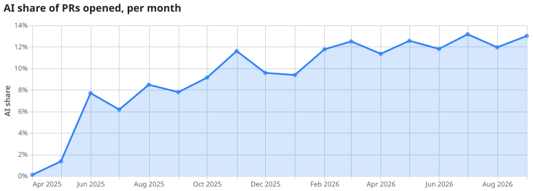
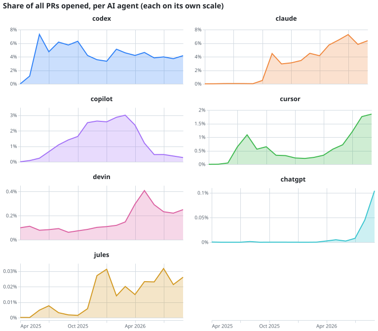

# AI Agent PR Tracker

How much of open source is now written by AI coding agents? (Whether their work gets merged is planned, not built yet.)

This pipeline processes every public pull request on GitHub (via [GH Archive](https://www.gharchive.org/))
and detects PRs opened by AI coding agents such as Claude, Codex, Cursor, Copilot, Jules and Devin.

## Results

<!-- stats:start -->
**Jan 2022 – Sep 2026:** 275,581,121 PRs opened, 6,368,473 (**2.3%**) by detected AI agents.

| Agent | PRs opened | Share of all PRs |
|---|---:|---:|
| codex | 2,898,076 | 1.05% |
| claude | 2,040,434 | 0.74% |
| copilot | 721,148 | 0.26% |
| cursor | 555,108 | 0.20% |
| devin | 122,496 | 0.04% |
| chatgpt | 21,318 | 0.01% |
| jules | 9,893 | 0.00% |
<!-- stats:end -->

<picture>
  <source media="(prefers-color-scheme: dark)" srcset="docs/img/ai_share-dark.svg">
  
</picture>
<picture>
  <source media="(prefers-color-scheme: dark)" srcset="docs/img/per_agent-dark.svg">
  
</picture>

**[View interactive charts →](https://edva-code.github.io/ai-agent-pr-checker/)** (hover for values,
drag on the share chart to zoom the agent charts)

Detected agents only, so a lower bound; capture varies by month (see [Data caveats](#data-caveats)).
Regenerate after a dbt build: `uv run python -m tracker.report`.

## Architecture

```
GH Archive (hourly .json.gz, ~15 MB)
  → ingest: stream + filter PR events, raw never stored       [Python]
  → data/events/date=YYYY-MM-DD/HH.parquet (~100 KB/hour)     [Parquet]
  → data/ingest_stats/…/HH.parquet (one row per hour: counts)  [manifest]
  → staging → agent detection → PR lifecycle → daily metrics  [dbt + DuckDB]
  → hourly schedule + backfills                               [Dagster]        (planned)
  → dashboard                                                 [Streamlit]
```

## How agents are detected

GitHub's public event stream no longer includes PR titles, descriptions or authors, so detection
relies on signals that remain:

- **Branch name prefixes** agents create by default: `claude/…`, `codex/…`, `cursor/…`, `copilot/…`
- **Bot accounts**: e.g. `devin-ai-integration[bot]`, `Copilot`

**Limitations:** a human can name a branch `claude/x`, and agents used with custom branch names leave
no trace. Reported figures are therefore *detected* AI-agent PRs and should be read as a lower bound.

## Quickstart

Requires [uv](https://docs.astral.sh/uv/).

```bash
uv sync
uv run tracker-ingest 2026-10-06T14                       # one hour
uv run tracker-ingest 2026-10-06T00 --end 2026-10-07T00   # one day
uv run tracker-ingest 2026-07-05T00 --end 2026-10-07T00 --workers 8   # 3 months, ~50 min
uv run pytest
```

Query the output directly with DuckDB:

```sql
SELECT split_part(head_ref, '/', 1) AS prefix, count(*) AS prs
FROM read_parquet('data/events/*/*.parquet', hive_partitioning = true)
WHERE event_type = 'PullRequestEvent' AND action = 'opened'
GROUP BY 1 ORDER BY 2 DESC LIMIT 15;
```

## Transformations (dbt + DuckDB)

```
source: data/events/*/*.parquet
  └─ stg_pr_events          incremental  one row per PR: its earliest opening event
       └─ int_agent_detection  table  PR → agent, using rules from seeds/agent_rules.csv
            └─ fct_prs           table  one row per PR opened inside the loaded window
                 └─ agg_daily_metrics  table  per day × agent: PRs opened, share of the day
```

Detection rules live in a seed (`transform/seeds/agent_rules.csv`), so adding a new agent is a
one-line CSV change, not a code change. Bot accounts take priority over branch prefixes.

```bash
uv run dbt build --project-dir transform --profiles-dir transform   # run from repo root
```

`dbt build` runs seeds, models and tests (uniqueness, not-null, accepted values,
relationships, plus custom tests such as "share of the day between 0 and 1").
The warehouse is `data/warehouse.duckdb`; all timestamps are bucketed in UTC.

### Dashboard

```bash
uv run streamlit run src/tracker/dashboard.py   # not while dbt build runs (DuckDB lock)
```

Sidebar filters: date range, AI agents, day/week/month. Tabs:

- **Overview**: totals and the AI share trend (selected agents / all PRs); capture-warning days marked in the Day view.
- **Agents**: PRs per agent over time, a leaderboard with change vs the previous same-length period, and when each agent first appeared (all data).
- **Year over year**: monthly AI share, one line per year.

### Data quality

Every ingested hour also writes a one-row manifest (`data/ingest_stats`) with lines read,
PR events kept and malformed lines — even when the hour had no PRs. dbt uses it to tell
"no PRs" apart from "never loaded":

- `capture_health` — one row per hour, flagged `missing`, `low` (< 0.5× the trailing week's
  median PR events), `high` (> 2×) or `ok`.
- `agg_daily_capture` — `capture_quality` per day (`partial` if any hour is missing, `low` if
  more than 6 hours are low), joined onto `agg_daily_metrics` so every number says how far
  to trust it.
- Tests: missing hours warn (> 24 fail the build), malformed rate > 0.1% fails, volume
  outliers warn, rates must be between 0 and 1.
- Source freshness: `uv run dbt source freshness --project-dir transform --profiles-dir transform`
  warns after 6h without new events and errors after 24h.

Over the three months: 1,541 hours ok, 413 high, 302 low, 0 missing; 78 days ok, 16 low.

### Data caveats

- **GH Archive volume change (2026-10-06 ≈17:00 UTC):** from this hour the archive stops
  containing push/create/delete events (~85k → ~7k events/hour), and the number of captured
  PR events roughly doubles. Absolute PR counts before and after are not comparable;
  agent *share* is the more robust metric.
- **Uneven capture:** PR events per hour range from ~50 to ~39k across the three months;
  the variance is upstream in GH Archive. `capture_quality` marks the affected days.

## Roadmap

- [x] Hourly ingestion to partitioned Parquet (idempotent, atomic writes, retries)
- [x] dbt models: staging (opened PRs), agent detection, daily metrics
- [ ] Merged/closed PRs (Parquet already keeps all PR events)
- [x] Data quality tests and freshness checks
- [ ] Dagster schedule and backfills
- [x] Streamlit dashboard
- [ ] Docker Compose and GitHub Actions CI
